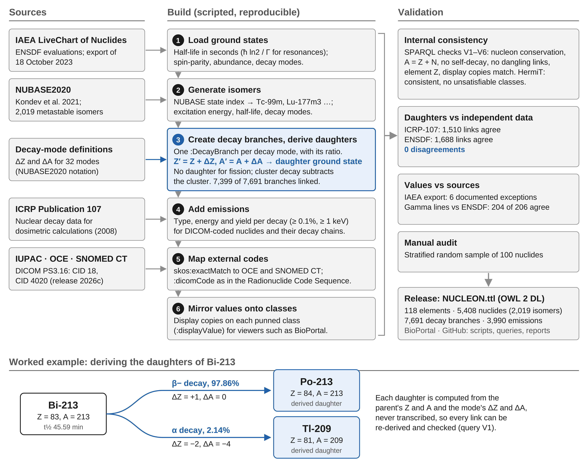

[](https://doi.org/10.5281/zenodo.23736195)

# NUCLEON &mdash; Nuclide and Element Ontology

The Nuclide and Element Ontology (NUCLEON) is a machine-processable knowledge resource that represents the 118 known chemical elements and 5,408 nuclides, including 2,019 metastable isomers, with computable nuclear properties.

Each element and nuclide is declared as both a class and an individual (OWL 2 punning). The class structure provides a taxonomy that aligns with vocabularies of chemistry and clinical medicine; the individuals carry the quantitative assertions, such as half-life. Each of 7,691 decay branches is an individual carrying its mode of decay and, where the source reports one, its branching ratio; 7,399 branches link explicitly to their decay product (daughter) nuclide.

Ground-state data come from the International Atomic Energy Agency (IAEA) LiveChart of Nuclides (ENSDF evaluations) and isomer data from the NUBASE2020 evaluation; symbols and names follow IUPAC nomenclature. NUCLEON is linked to the Ontology of Chemical Elements, SNOMED CT, and the DICOM radiopharmaceutical isotope (CID 18) and PET radionuclide (CID 4020) context groups, so a nuclide can be resolved directly from a DICOM Radionuclide Code Sequence. Element names are provided in seven languages.

NUCLEON is also available from [NCBO BioPortal](https://bioportal.bioontology.org/ontologies/NUCLEON).

## How NUCLEON is built



Sources feed scripted build steps; every decay product is derived from the decay mode's change in Z and A, and the result is checked internally and against independent data. Regenerate the figure with `python3 docs/figures/make_methods_figure.py` (SVG, PDF and 600-dpi PNG).

## Contents

| Path | Description |
| --- | --- |
| [`NUCLEON.ttl`](NUCLEON.ttl) | The ontology, OWL 2 DL in Turtle |
| [`nucleon_queries.rq`](nucleon_queries.rq) | Example SPARQL queries (Q1&ndash;Q7) and validation queries (V1&ndash;V6) |
| [`scripts/validate.py`](scripts/validate.py) | Runs every query, reports content counts and structural checks |
| [`scripts/rebuild_isomers.py`](scripts/rebuild_isomers.py), [`nubase.py`](scripts/nubase.py) | Generate all metastable isomers and their decay branches from NUBASE2020 |
| [`scripts/add_emissions.py`](scripts/add_emissions.py), [`compare_emissions.py`](scripts/compare_emissions.py) | Add radiation emissions from ICRP Publication 107, and cross-check gamma lines against ENSDF |
| [`scripts/download_iaea.py`](scripts/download_iaea.py) | Downloads the IAEA LiveChart ground-state export (and optionally excited levels) |
| [`scripts/reload_from_source.py`](scripts/reload_from_source.py), [`retire_legacy_fields.py`](scripts/retire_legacy_fields.py) | Load ground-state values from the IAEA export, with NUBASE2020 where it has none |
| [`scripts/add_display_annotations.py`](scripts/add_display_annotations.py) | Regenerates the class-level display annotations and decay summaries; rerun after any data change |
| [`validation/`](validation) | Validation results: internal checks, daughter comparison against ICRP-107 and ENSDF, comparison with the IAEA source, and the manual audit sample; see [`validation/README.md`](validation/README.md) |
| [`scripts/compare_daughters.py`](scripts/compare_daughters.py), [`compare_to_source.py`](scripts/compare_to_source.py), [`draw_audit_sample.py`](scripts/draw_audit_sample.py) | Scripts that produce those results |
| [`source-data/`](source-data) | IAEA LiveChart export and the decay-mode reference table |

## Content (v1.0)

| Entity or property | Count |
| --- | ---: |
| Triples | 215,862 |
| Elements | 118 |
| Nuclides | 5,408 |
| &nbsp;&nbsp;metastable isomers | 2,019 |
| &nbsp;&nbsp;flagged stable | 245 |
| &nbsp;&nbsp;with a half-life | 4,989 |
| &nbsp;&nbsp;with at least one decay branch | 5,122 |
| Decay branches | 7,691 |
| &nbsp;&nbsp;with a decay product | 7,399 |
| Decay modes | 32 |
| Emissions (ICRP-107), for 123 radionuclides | 3,990 |
| `skos:exactMatch` assertions | 287 |
| Nuclides with a DICOM code | 87 |

Of the 292 branches without a decay product, 255 are fission branches (products vary by event), 5 bundle fission with electron capture/beta-plus decay, and 32 lead to a daughter not in the ontology. Of the 286 nuclides without a branch, 237 are stable and 49 are radioactive with no decay mode reported by the source (48 ground states, 1 isomer). Stability follows the IAEA export: primordial nuclides with a measured or bounded half-life (e.g. Bi-209, 2.01&times;10<sup>19</sup> a; W-180) are radioactive, while 8 nuclides the export lists as stable (e.g. Cd-106, Se-80) still carry the predicted double-beta or alpha mode it gives for them.

## Validation

```
pip install rdflib
python3 scripts/validate.py
```

The script runs every query in `nucleon_queries.rq` over asserted triples only (no reasoner is needed) and exits non-zero if any validation query or structural check fails. V1 confirms nucleon conservation across every asserted daughter link; because daughters are derived with that same arithmetic, it verifies internal consistency, not independent physical correctness. The ontology is consistent, with no unsatisfiable classes, under both HermiT 1.3.8 and Pellet 2.3.1 (`python3 scripts/check_reasoners.py`).

Derived parent&ndash;daughter links have also been compared with ICRP Publication 107 and ENSDF, which list daughters explicitly: no link disagrees with either. Every ground-state value is also checked against the IAEA source export. See [`validation/README.md`](validation/README.md).

## Using the ontology

- Physical values are asserted on the **individual** reading of each IRI, as datatype properties; these are authoritative and are what queries should use. Protégé, the OWL API, rdflib, and SPARQL endpoints read both readings.
- For class-oriented viewers such as BioPortal, the same values are **mirrored onto the class reading** as annotation properties (`:atomicNumberDisplay`, `:halfLifeDisplay`, &hellip;), each a sub-property of `:displayValue` that names its source with `:mirrorOf`. Each nuclide also carries a one-line `:decaySummary`, e.g. `"β− 97.86% → Po-213; α 2.14% → Tl-209"`. The mirrors are generated by `scripts/add_display_annotations.py`; V6 and `validate.py` check that they match.
- **owlready2 reads a punned IRI only as a class**, so the datatype properties are invisible to it, but the display annotations are visible; for computation, use rdflib or SPARQL.
- **Emissions.** The 87 DICOM-coded radionuclides and the radioactive members of their decay chains (123 in ICRP Publication 107) link by `:hasEmission` to `:Emission` individuals with `:hasRadiationType` (14 ICRP-107 types: gamma ray, X-ray, annihilation photon, beta-minus particle, positron, conversion and Auger electrons, alpha particle, ...), `:emissionEnergy` (keV; mean energy for beta particles) and `:emissionYield` (per decay). Emissions with yield of at least 0.1% and energy of at least 1 keV are included; full spectra are in ICRP-107. Each such nuclide's class carries an `:emissionSummary` for display.
- `:halfLife` is always in seconds (`xsd:double`); the source value and unit are kept in `:halfLifeValue` and `:halfLifeUnit`.
- **Sources.** Ground states: IAEA LiveChart of Nuclides export (ENSDF; extracted 18 October 2023), in `source-data/`. Metastable isomers, and the few ground-state values the export lacks: NUBASE2020 (Kondev et al., *Chin. Phys. C* 45:030001, 2021), also in `source-data/`. Daughters are derived. See [`validation/README.md`](validation/README.md#sources).
- **Isomer names** follow NUBASE2020's state index: m, n, p, &hellip; become `m`, `m2`, `m3`, &hellip; NUBASE numbers states by excitation energy, so a long-lived isomer above shorter-lived ones has a higher suffix: the 160.4-d Lu-177 isomer is `:Lu-177m3`, the 58.6-h Sc-44 isomer `:Sc-44m3`. Use `:excitationEnergy` (keV) or `:halfLife` to identify a state.
- Following the source's convention, delayed-particle channels (e.g. beta-delayed neutron emission) are sub-channels of their parent beta decay, so a nuclide's branching ratios can sum to more than 100.
- Uncertainties are not represented; values are central values. Limit or approximate branching ratios carry an `rdfs:comment`.
- Nuclides used in nuclear medicine can be selected by `:dicomContextGroup` (CID 18 or CID 4020).

## Changes in v0.6 (was labeled "v1.6" in GitHub)

- **Object properties renamed** so that no property shares a name with a class: `:decayMode` is now `:hasDecayMode` (it was easily confused with the class `:DecayMode`), `:decayProduct` is now `:hasDecayProduct`, and `:radiationType` is now `:hasRadiationType`. Labels changed to match ("has decay mode", ...). The old IRIs are not kept; update SPARQL queries accordingly. No values changed.

## Changes in v0.5

- **Licence changed to CC BY-NC-ND 4.0**, consistent with the non-commercial terms of the ICRP-107 emission data.
- **Radiation emissions** from ICRP Publication 107 for the DICOM-coded radionuclides and their decay chains: new classes `:Emission` and `:RadiationType`, properties `:hasEmission`, `:radiationType` (renamed `:hasRadiationType` in v0.6), `:emissionEnergy`, `:emissionYield`, display annotation `:emissionSummary`; 3,990 emissions for 123 nuclides. New example query Q8.

## Changes in v0.4

- **Isomers from NUBASE2020.** All 2,019 NUBASE2020 isomers (states with a half-life), with excitation energy (new property `:excitationEnergy`), half-life, spin-parity, decay modes and branching ratios. Of the 716 earlier isomers, 626 keep their IRI, 66 are renamed to NUBASE's numbering, and 24 with no NUBASE2020 state (mostly actinide fission isomers) are removed. 64 earlier IRIs now denote a different state (e.g. `:Lu-177m`); see `validation/isomer_mapping.csv`.
- **Stability flags aligned with the IAEA export.** Bi-209, W-180, Eu-151, Cd-116, Xe-134, Ba-132 and Ce-138 are now radioactive, with the export's half-lives; Sm-149 and W-184 are stable (their spreadsheet half-lives removed). Changes in `validation/stability_alignment_log.csv`.
- **No spreadsheet data remain.** Ground-state spin-parity from the IAEA export (NUBASE2020 where absent); 10 ground-state half-lives the export lacks from NUBASE2020; Q-values from the export; the `:decayModeOrAbundance` free text removed.
- Added `scripts/download_iaea.py`, `scripts/rebuild_isomers.py`, `scripts/nubase.py`, `scripts/retire_legacy_fields.py`; `source-data/nubase_3.mas20.txt`.
- Daughter comparison matches ENSDF isomer levels by excitation energy.

## Changes in v0.3

- Reloaded half-lives, decay widths and half-life limit notes for 1,095 ground states from the IAEA export, replacing values from an earlier build. Fixes the Na-24 half-life (recorded in seconds instead of hours).
- Swapped back the Np-242 (2.2 min) and Np-242m (5.5 min) half-lives.
- Added natural abundance to the 287 naturally occurring nuclides.
- Added `scripts/reload_from_source.py`; every change is logged in `validation/reload_from_source_log.csv`.

## Changes in v0.2

- Mirrored the physical values on each element and nuclide onto its class as annotation properties under `:displayValue`, and added `:decaySummary`, so BioPortal and class-only tools display them.
- Added validation query V6 and a `validate.py` check that every mirror and summary matches its source.

## Changes in v0.1

- Added 971 decay branches for 636 metastable isomers (e.g. Kr-81m, In-113m, Tc-94m, Mn-52m), parsed from the source decay text; daughters derived as for ground states.
- Tc-99m: isomeric transition corrected to 99.9963%; 0.0037% beta-minus branch to Ru-99 added.
- Removed `:isMedicalIsotope`, whose criterion was undocumented; use `:dicomContextGroup`.
- Added license (CC BY 4.0, since changed to CC BY-NC-ND 4.0), validation script, and validation report.

## License

NUCLEON is released under the [Creative Commons Attribution-NonCommercial-NoDerivatives 4.0 International license](LICENSE) (CC BY-NC-ND 4.0). The emission data are taken from ICRP Publication 107, whose data files may be used, copied and distributed for educational, research and not-for-profit purposes ([`source-data/LICENSE.ICRP-07`](source-data/LICENSE.ICRP-07)). SNOMED CT identifiers are included as cross-references only; use of SNOMED CT content is subject to the SNOMED International license.
